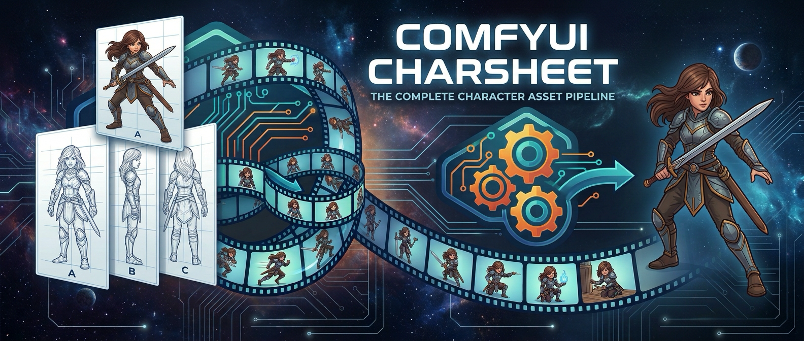

# 🎨 ComfyUI CharSheet

**5-view character sheets for ComfyUI** — close-up, front, left profile, right profile, back on one canvas, ready for keyframe/IC-LoRA pipelines.

[](LICENSE)
[](pyproject.toml)
[](https://registry.comfy.org/publishers/huchukato/nodes/comfyui-charsheet)
[](https://github.com/huchukato/ComfyUI-CharSheet/stargazers)



# ComfyUI CharSheet

Small ComfyUI nodes for building 5-view character sheets (close-up, front, left profile, right profile, back) — designed for Qwen Image Edit / image-edit turnaround pipelines, works with any IMAGE source.

## Nodes

- **Character Sheet Compositor** — takes 5 IMAGE inputs and lays them out side by side on one sheet. Every panel is scaled to a shared height; the close-up stays full width, the other four get a centered width crop (`body_width_pct`) so they read as thinner panels. `target_aspect_ratio` solves the crop automatically so the canvas lands exactly on 16:9, 4:3, 1:1, 3:2 or 21:9.
- **Images to RGB** — converts IMAGE batches to RGB, preserving alpha, or compositing transparency onto a chosen `#RRGGBB` background.
- **Save Text** — saves STRING text to any writable folder with automatic numbering (`{date}` supported). Never overwrites existing files.

## Install

Clone into `ComfyUI/custom_nodes/`:

```bash
git clone https://github.com/huchukato/ComfyUI-CharSheet
```

No extra dependencies — only ComfyUI itself (torch, PIL, numpy).

## Usage

Generate the 5 views with your image-edit model (e.g. Qwen Image Edit with `<image1>` reference views), extract each frame, feed the five IMAGE outputs into **Character Sheet Compositor**, and save the sheet. The resulting sheet is a ready reference image for keyframe/IC-LoRA workflows.

## License

MIT. Based on the Character Sheet Compositor from [Muse-CharacterSheet-H3](https://github.com/muse-collective-26/Muse-CharacterSheet-H3) (Muse Collective, MIT).
